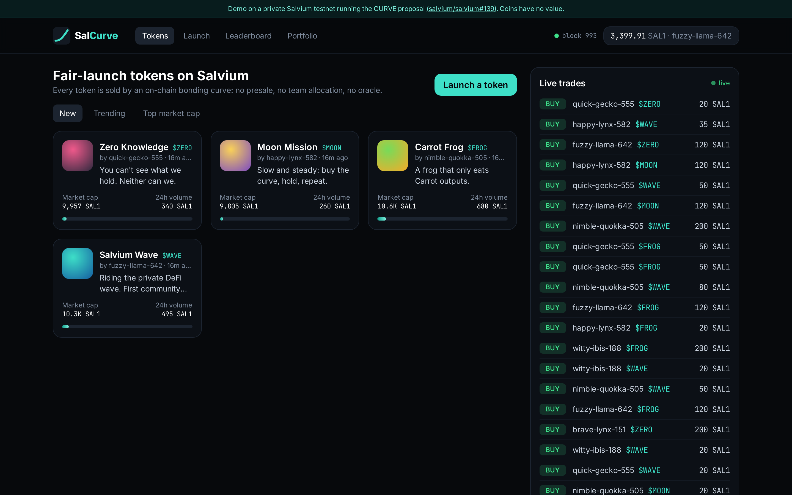
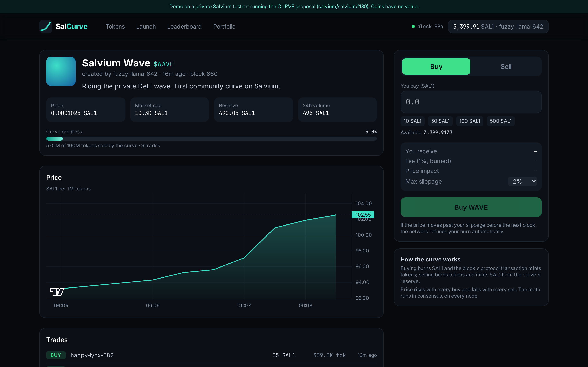
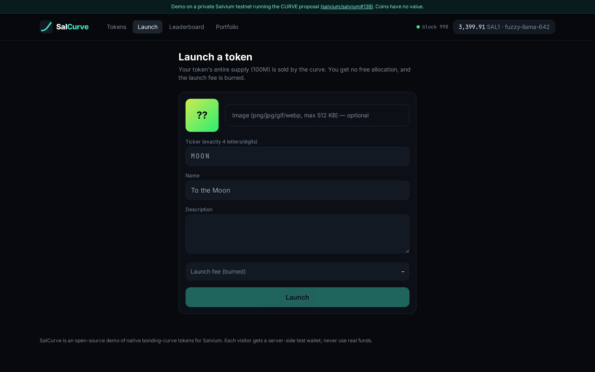
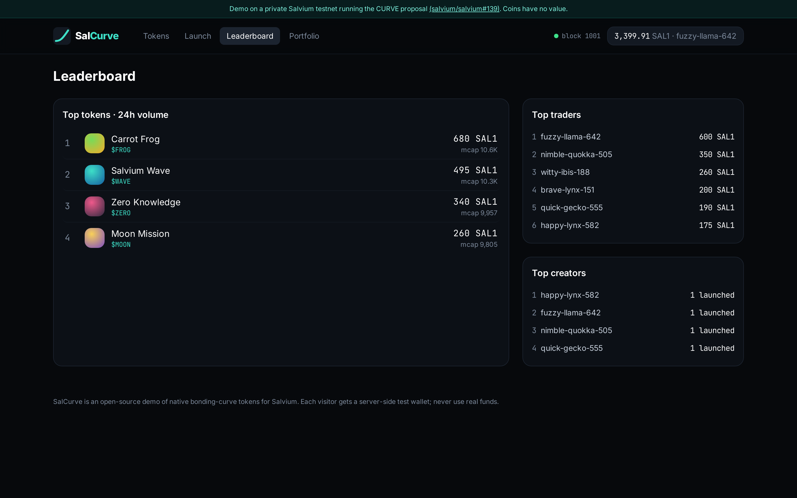
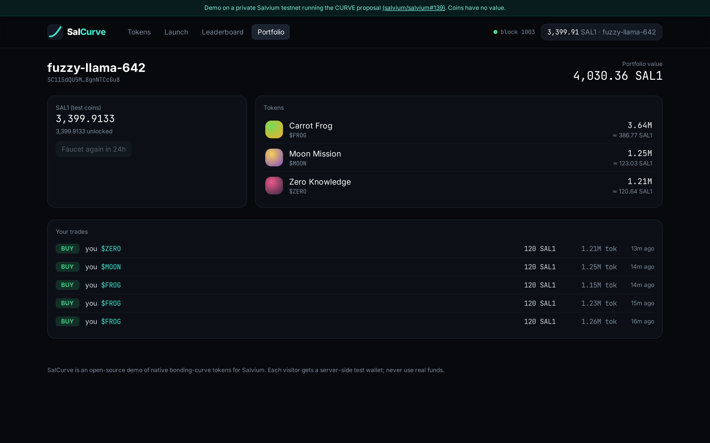
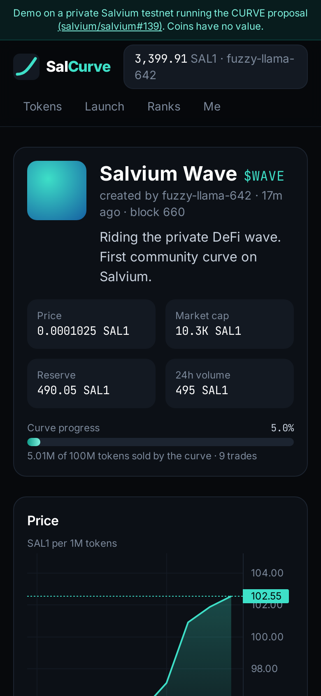

# SalCurve

**Fair-launch bonding-curve tokens on Salvium**: a pump.fun-style web app built on the
native `CURVE` transaction type proposed in
[salvium/salvium#139](https://github.com/salvium/salvium/pull/139).

> **Demo only.** CURVE is a proposal: it is not on Salvium mainnet. SalCurve runs against a
> private regtest chain built from that PR. Coins have no value, and each visitor gets a
> server-side test wallet.



## What it does

- **Launch** a token: ticker, name, description and image. The whole 100M supply is sold by the
  curve, with no presale and no team allocation; the launch fee is burned.
- **Trade** on the curve with live quotes, price impact and a slippage limit. If the price
  moves past the limit before the next block, the network refunds the burn automatically.
- **Browse** tokens (New, Trending, Top market cap) with a price chart, curve progress, trade
  history, a live trade feed, your portfolio and leaderboards.

Every price and payout is computed **by Salvium consensus**: buys burn SAL1 and the block's
protocol transaction mints tokens; sells burn tokens and mint SAL1 back from the curve's
reserve. The backend only indexes what the chain did. It cross-checks every trade against the
executable spec (`backend/curve_model.py`) and adopts the chain state if they ever disagree.

## Screenshots

| Token page: chart, curve progress, buy/sell | Launch a token |
|---|---|
|  |  |
| **Leaderboard** | **Portfolio** |
|  |  |

<p align="center"></p>

## Architecture

```
browser ──> FastAPI backend (port 8080) ──> salviumd --regtest        (CURVE build)
            │                           └─> salvium-wallet-rpc        (one wallet file per visitor)
            └─ serves the React build       SQLite: visitors, token metadata, indexed trades
```

- `backend/chain.py`:
  - produces a block every 3 s (and one right after each action);
  - indexes CURVE txs with `get_block` and `get_curve_tx`;
  - caches visitor balances.
- `backend/wallets.py`: the house wallet (block rewards, faucet) and visitor wallets.
  `salvium-wallet-rpc` keeps one wallet open, so access is serialised.
- `frontend/`: Vite + React + TypeScript + Tailwind. Charts use
  [lightweight-charts](https://github.com/tradingview/lightweight-charts) (MIT).

## Run it yourself

The public demo only runs while its host is up. You can run your own private copy:
a Salvium test chain and the web app, on your own computer. Nothing touches mainnet.

**Requirements**
- **Ubuntu 22.04 or 24.04**. On Windows use **WSL2**: `wsl --install -d Ubuntu-24.04` in an
  admin PowerShell, then open "Ubuntu" from the Start menu.
- 4+ CPU cores, 8 GB RAM and ~15 GB free disk. The first build takes 30–90 minutes.
- Node.js 18+ (`sudo apt install nodejs npm`, or from https://nodejs.org) and Python 3.10+.

**Step 1: get SalCurve**
```bash
git clone https://github.com/juanjobs39-cloud/salcurve.git
cd salcurve
```

**Step 2: build Salvium with the CURVE proposal.** This installs the build dependencies, fetches
[salvium/salvium#139](https://github.com/salvium/salvium/pull/139) (CURVE) and
[#121](https://github.com/salvium/salvium/pull/121) (wallet `--regtest`), and builds
`salviumd` and `salvium-wallet-rpc` into `../salvium-curve/build/bin`.
```bash
./setup_salvium.sh
```
The script also lowers the wallet's subaddress lookahead (50/200 → 2/20). Opening a wallet then
takes ~3 s instead of ~30 s, which matters because the backend switches wallets per visitor.
This is a demo-only change and is not part of the PR.

**Step 3: build the web app**
```bash
cd frontend && npm install && npm run build && cd ..
```

**Step 4: start everything.** This starts a private regtest chain, the wallet RPC and the app on
port 8080. The first start mines 600 blocks (a minute or two) so the faucet has mature coins.
```bash
FRESH=1 SALVIUM_BIN=../salvium-curve/build/bin ./run_demo.sh
```
Open **http://127.0.0.1:8080**. Every browser gets its own test wallet with 5,000 test SAL1.
To try it as two different people, use a normal and a private window.

**Optional**
- Pre-fill the demo with tokens and trades: `python3 backend/seed_demo.py`.
- Automated end-to-end check with two visitors: `python3 backend/smoke_test.py`.
- Restart later and keep the chain: `SALVIUM_BIN=../salvium-curve/build/bin ./run_demo.sh`.
  Start over: add `FRESH=1`.
- Logs: `~/salcurve-data/logs/` (daemon, wallet RPC); the app logs to the terminal.

**Troubleshooting**
- *"Failed to bind" in the wallet log:* a previous run is still shutting down. Wait a few
  seconds and run the script again.
- *Balance stays at 0:* coins unlock after ~10 blocks (faucet) or 60 blocks (tokens you bought).
  At one block every 3 s that is 30 s and 3 min.
- *Port 8080 busy:* `PORT=9090 ./run_demo.sh`.

## Known limitations

- **Single wallet RPC:** visitor wallets are switched one at a time, so heavy concurrent use
  queues up.
- **Custodial test wallets:** the server holds every visitor wallet. A non-custodial version
  would connect the user's own `salvium-wallet-rpc`.
- **No accounts:** identity is a random key kept in the browser.
- **Lock times:** minted outputs unlock after 60 blocks (about 3 minutes at 3 s/block).

## License

MIT
